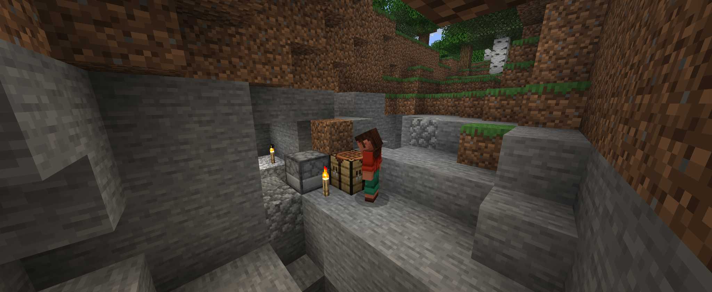
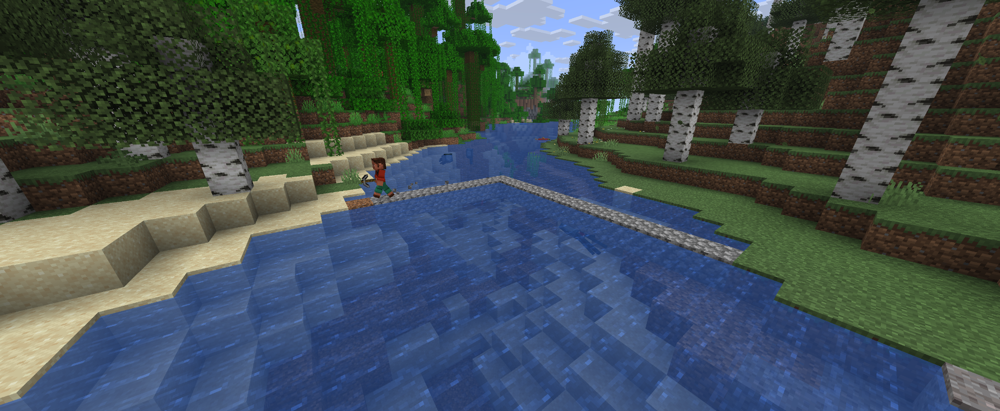
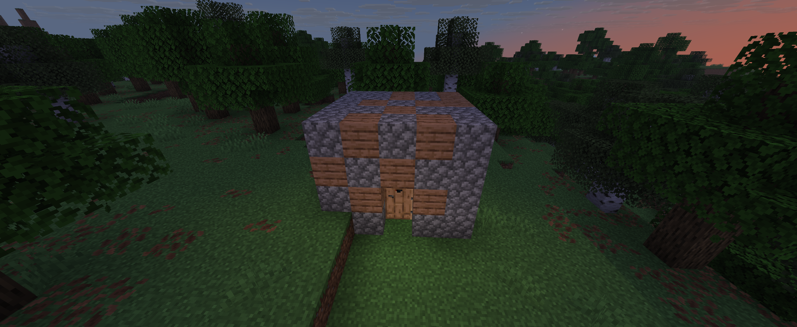
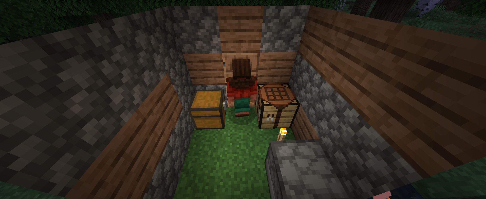
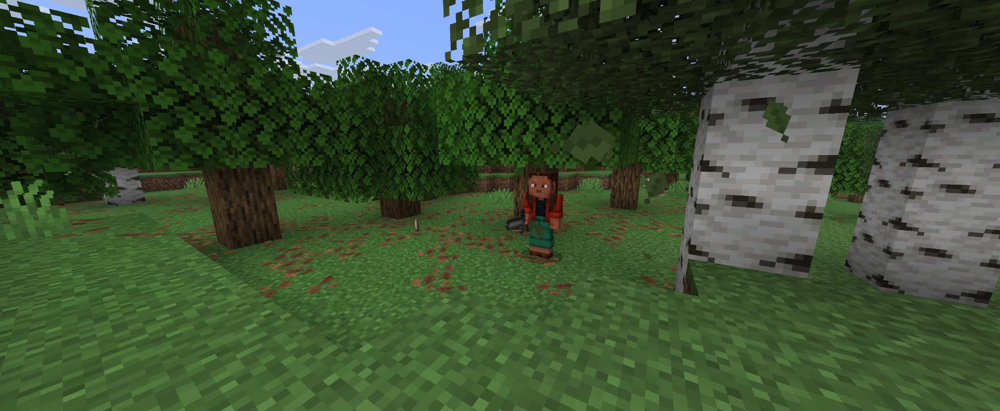

# Project Genesis – Development Screenshots

**Language / Sprache:** [Deutsch](GALLERY.md) | English

[Back to the project overview](README.en.md)

## A look at development on 12 October 2026

Screenshots from the development of Project Genesis, taken during an observation session.

### An outdoor work area

The test agent beside a furnace, crafting table and torches.

### By the river

The agent on the riverbank beside a narrow crossing made of stone blocks.

### A shelter in the forest

An exterior view of the simple wood-and-cobblestone shelter at dusk.

### Inside the shelter

The agent inside the shelter with a chest, crafting table, furnace and lighting.

### Out in the forest

The test agent among the trees with a sword equipped.

---

[Support Project Genesis on GoFundMe](https://gofund.me/24c331f9d)
